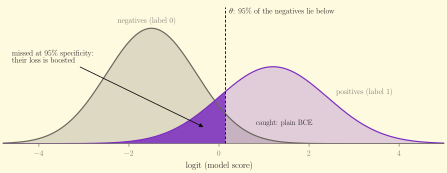

# aucreshape

[](https://github.com/ibouftini/AUCReshaping/actions/workflows/ci.yml)
[](https://ibouftini.github.io/AUCReshaping/)
[](https://github.com/ibouftini/AUCReshaping)
[](LICENSE)

`aucreshape` is a PyTorch implementation of
[AUCReshaping](https://doi.org/10.1038/s41598-023-48482-x) (Bhat et al., *Scientific Reports*
2023). While a classifier is fine-tuned, it boosts the loss of the positives that are
misclassified at a high-specificity threshold (for example 95% or 98% specificity), with the
aim of raising sensitivity at that operating point.

It is a drop-in replacement for `nn.BCEWithLogitsLoss`: binary or multi-label, any model, any
data loader, CPU/GPU, AMP, DDP, checkpointing, Lightning and Hugging Face.

Status: the library is finished and tested. It is not published on PyPI; install it from GitHub.
Its evaluation is being redone under a stricter [protocol](benchmarks/PROTOCOL.md), fixed before the
new runs, because a review found gaps in the first one. The code is in [`benchmarks/`](benchmarks/). [Results](#results)
describes the first evaluation, and may change: there, AUCReshaping rarely did better than a tuned
weighted BCE.

## Install

```bash
pip install "aucreshape @ git+https://github.com/ibouftini/AUCReshaping"              # needs only torch >= 2.1
pip install "aucreshape[lightning] @ git+https://github.com/ibouftini/AUCReshaping"   # optional Lightning callback
```

or, from a clone: `pip install .` (add `-e` for an editable install).

## Quickstart

```python
import torch
from aucreshape import AUCReshapingLoss, metrics

x = torch.randn(4096, 10)
y = (x[:, 0] + x[:, 1] ** 2 + torch.randn(4096) > 2.5).float()  # imbalanced labels
model = torch.nn.Sequential(torch.nn.Linear(10, 32), torch.nn.ReLU(), torch.nn.Linear(32, 1))
criterion = AUCReshapingLoss(0.95, boost=0.2, warmup_steps=150)  # was BCEWithLogitsLoss()
optimizer = torch.optim.Adam(model.parameters(), lr=1e-2)
for step in range(200):
    loss = criterion(model(x).squeeze(-1), y)  # label 1 = the class to detect
    optimizer.zero_grad()
    loss.backward()
    optimizer.step()
print(metrics.sensitivity_at_specificity(model(x).squeeze(-1).detach(), y, 0.95))
```

The first 150 steps are plain BCE (`warmup_steps`); the last 50 fine-tune with AUCReshaping.
Train with BCE first, then switch the loss: AUCReshaping is a fine-tuning method, and on an
under-trained model it can hurt (see [Results](#results)).

## Common mistakes

- **`model.eval()` does not switch the criterion.** Run validation under `torch.no_grad()`
  (or call `criterion.eval()` and later `criterion.train()`). Otherwise validation batches
  feed the threshold tracker; the loss warns when it detects this.
- **Validation BCE is expected to rise** while sensitivity at your operating point improves.
  Do not early-stop or schedule the learning rate on validation loss; select checkpoints on
  `metrics.sensitivity_at_specificity(val_logits, val_targets, s)`.
- **Converting a script that trains from scratch:** keep its BCE epochs as warm-up
  (`warmup_steps = bce_epochs * len(train_loader)`, counted in micro-batches), then add 1-3
  fine-tuning epochs at 0.1 to 0.3 times the learning rate, and pick the best epoch on validation
  sensitivity.
- If validation AUC is near 0.5, fix the model first: no loss reshapes a ROC curve that is
  not there.
- `criterion.last_stats` describes the **last batch** only; average it yourself for per-epoch
  logs.

## How it works

1. A **threshold tracker** estimates, from recent training batches, the logit $\theta$ at which the
   negatives (label 0) reach the target specificity, e.g. the 95th percentile of their logits.
2. Positives with a logit below $\theta$ are the ones you would miss at that operating point.
3. Their loss is boosted. The paper's Eq. 1 replaces `-log p` with `-log(p - b)`; a detached
   floor keeps it defined and the gradient alive when $p \le b$.
4. Everything else gets exactly the BCE loss. Outside training (`eval()` or `no_grad()`) the
   loss is plain BCE, so validation losses stay comparable.
5. Several specificities can carry different boosts (`band`, `sum` or `max` combination), and
   the boost can be a probability offset (`prob`, the paper), a logit margin or a loss weight.

<picture>
  <source media="(prefers-color-scheme: dark)" srcset="docs/figures/how-it-works-dark.svg">
  
</picture>

## The label convention

**Label 1 is the class whose sensitivity you want to raise; label 0 is the class whose
specificity you hold fixed.** With disease = 1, use it as is. The paper calls the *normal*
class positive (e.g. "flag at least 99% of fraud, pass as many normal transactions as possible"):
with `fraud = 1` labels, call `criterion(-logits, 1 - targets)`.

## Features

| | |
|---|---|
| Drop-in | `criterion(logits, targets)`, `reduction`, `pos_weight`, `weight`; boost 0 gives plain BCE |
| Shapes | `(N,)`, `(N, 1)`, `(N, C)` multi-label, `mask=` for missing labels |
| Thresholds | `ThresholdTracker` strategies `window` (default), `batch`, `ema`, `epoch`, `fixed`; `from_scores`/`calibrate` for validation thresholds |
| Composable | `reshaping_weights(...)` for any per-sample loss (focal, label smoothing, ...) |
| Safe | finite loss and gradients for every finite logit; no host syncs in forward; AMP and `torch.compile` |
| Engineering | DDP-correct (all-gather), checkpointable (`state_dict`), Lightning callback, HF `Trainer` recipe |
| Metrics | `threshold_at_specificity`, `sensitivity_at_specificity`, `sensitivity_at_threshold`, `partial_auc` (tested against scikit-learn) |

Examples for every integration are in [`examples/`](examples/) and run in CI. Full
documentation: **[ibouftini.github.io/AUCReshaping](https://ibouftini.github.io/AUCReshaping/)**.

## Choosing hyperparameters

- `target_specificity`: the operating point you deploy at.
- `boost` (default mode `prob`): 0.1-0.4. Sweep 3-4 values on *validation sensitivity at the
  target specificity*, not on the loss.
- The tracker needs about `10 / (1 - s)` negatives (200 at 0.95, 500 at 0.98) before it boosts;
  it warns if it never gets them. For rare negatives, use thresholds from a validation pass
  (`ThresholdTracker.from_scores`).

## Results

We evaluated AUCReshaping against CE (plain BCE), weighted BCE and focal loss in three studies,
with the same training budget for every method and settings chosen on validation data:
six public datasets (5 seeds), a synthetic laboratory of eight realistic scenarios (10 seeds),
and NIH ChestX-ray14 end to end with a SwAV ResNet-50 for 200 epochs (2 seeds). The synthetic
laboratory and the chest X-ray runs include a control that gives the same boosts to randomly
chosen positives.

- AUCReshaping raised sensitivity at 98% specificity by about 1 to 3 points where giving the
  positive class more weight helps in general: few training positives, small models, small
  datasets. A tuned weighted BCE did as well or better there, and so did the random-positive
  control, so the gain comes from up-weighting positives rather than from targeting the
  operating point.
- It did not help, or lost up to about 5 points, when a linear score cannot capture how the
  classes differ, with mislabelled positives, when look-alike negatives became more common
  after training, and with large networks trained for long.
- On NIH chest X-rays it could not be told apart from CE (effusion: +1.2 and -0.7 points on the
  two seeds).

If you want to try it, compare it with a tuned `pos_weight` on your own validation data.
Figures, tables, the controls and the limitations are on the
[Results page](https://ibouftini.github.io/AUCReshaping/results/).

## How it compares

| | changes the loss | targets the operating point | needs extra state |
|---|---|---|---|
| weighted BCE (`pos_weight`) | re-weights all positives | no | no |
| focal loss | re-weights hard examples everywhere | no | no |
| LibAUC partial-AUC losses | replaces BCE with a pairwise AUC surrogate | the FPR range | per-sample buffers, special samplers |
| **AUCReshaping** | boosts only positives missed at the threshold | **yes** | a small threshold tracker |

## Citation

If you use this software, please cite the paper (and this repository, see `CITATION.cff`):

```bibtex
@article{bhat2023aucreshaping,
  title   = {AUCReshaping: improved sensitivity at high-specificity},
  author  = {Bhat, Sheethal and Mansoor, Awais and Georgescu, Bogdan and Panambur, Adarsh B.
             and Ghesu, Florin C. and Islam, Saahil and Packh{\"a}user, Kai
             and Rodr{\'i}guez-Salas, Dalia and Grbic, Sasa and Maier, Andreas},
  journal = {Scientific Reports},
  volume  = {13},
  pages   = {21097},
  year    = {2023},
  doi     = {10.1038/s41598-023-48482-x}
}
```

This is an independent, clean-room implementation from the paper; it is not affiliated with
the authors or Siemens Healthineers.

## Development

```bash
uv sync --all-groups
uv run ruff format . && uv run ruff check . && uv run mypy src
uv run pytest
```

CI fails if test coverage of `src/` drops below 90%.
