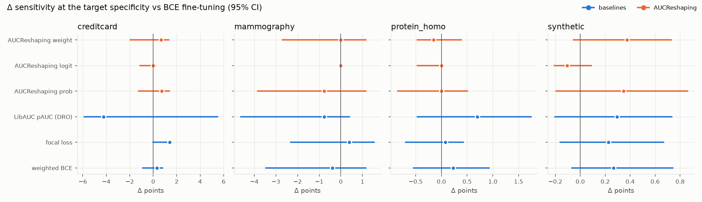
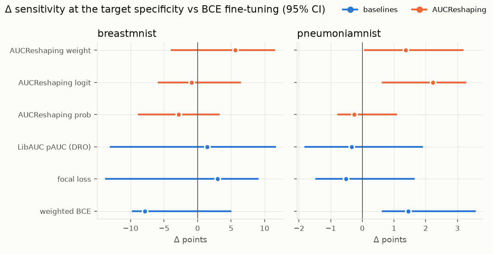

# Results

!!! warning "This evaluation is being redone"
    A review of this evaluation found gaps, so it is being repeated under a stricter protocol,
    published before the new runs. The code is in the repository's `benchmarks` folder.
    Until then, read it with these corrections in mind, which come from an audit and an independent
    review:

    - In six of the eight synthetic scenarios, the row named "AUCReshaping" uses our `weight`
      variant with a boost of 16, not the paper's Eq. 1. The paper's form gains less.
    - The chest X-ray study has 2 seeds and no tuned weighted BCE arm, so it cannot separate the
      methods.
    - The credit-card runs used SGD with momentum 0.9, which was our own choice. Without momentum,
      our baseline matches the paper's (sensitivity 0.746 at 98% specificity against 0.73, over 6
      data splits), so the earlier runs were not a fair repeat of the paper's comparison.
    - The random-positive control differs from AUCReshaping in the strength of its boost as well as
      in who receives it, and most of its recipients would be boosted anyway. A tie with it does
      not show that choosing which positives to boost is useless.
    - The strength of the paper's form depends heavily on how we handle $p \le b$, which the paper
      does not specify, and we ran it at the strong end. Only that one setting was tried.

This page reports how AUCReshaping performed in our evaluation, and when it is worth trying.
Unless stated otherwise, every number is a difference in percentage points (points) of
sensitivity at the target specificity, against a cross-entropy (CE, plain BCE) baseline
trained the same way, with a 95% interval and the number of seeds that showed a gain.

## Summary

AUCReshaping raised sensitivity at high specificity by about 1 to 3 points in some
settings: few positives in the training set, small models, small datasets. In those
settings two simpler things worked as well or better:

- a weighted BCE with a tuned `pos_weight`;
- boosting the same number of *randomly chosen* positives instead of the positives that are
  missed at the operating point.

So the gains came from giving the positive class more weight, not from targeting the
operating point. In other settings AUCReshaping did not help or lost sensitivity: when a
linear score cannot capture how the classes differ, when positive labels are noisy, when
negatives that look like positives become more common after training, and when a large
network is trained for a long time. End to end on NIH chest X-rays it could not be told
apart from CE.

## Should you use it?

It may be worth trying when:

- the training set has few positives (tens to a few hundred) or the model is small, and you
  already consider class weights; compare it with a tuned `pos_weight` on your validation
  data;
- you need a published re-weighting method as a baseline in a comparison of losses.

It is not recommended when:

- positive labels are noisy, for example mined from reports;
- negatives that resemble positives are common, or may become more common after deployment;
- you fine-tune a large network end to end for many epochs: the network fits the training
  positives, and the boost has nothing left to act on;
- the model is still learning: fine-tuning an under-trained model lost 2.1 points in our
  first experiment.

In all cases, try a tuned `pos_weight` first.

## How we tested

Three studies, each with its protocol fixed before the runs; the few changes made later are
stated where they apply:

1. **A synthetic laboratory**: eight scenarios, each mirroring a real situation and
   testing one effect, with 10 seeds. Synthetic data is the only way to know the best
   achievable result and the true noise rate.
2. **End-to-end chest X-ray**: NIH ChestX-ray14 with its official patient-wise test
   split, a self-supervised SwAV ResNet-50 as in the paper, 200 epochs, 2 seeds.
3. **Public datasets**: four tabular and two image datasets, 5 seeds.

Every method gets the same model, optimiser, learning rate, epochs and tuning budget.
Settings and checkpoints are chosen on validation data, never on the test set, and every run
is reported.

The synthetic laboratory and the chest X-ray runs include **controls**: losses that differ
from AUCReshaping in one respect only. They separate what the method does from what any
up-weighting of positives does.

- *Same boosts, random positives*: the boosts AUCReshaping would give, moved to positives
  chosen at random. If AUCReshaping's choice of positives matters, it beats this control.
- *Boost every positive*: the same boost for all positives once the threshold is known.
- *Boost detected positives*: the boost goes to positives *above* the threshold, the ones
  already caught (a placebo for the targeting).
- *Thresholds from the true distribution* (synthetic only): AUCReshaping with exact
  thresholds instead of estimated ones, to rule out threshold noise.

## Synthetic laboratory

**Setup.** 20 features; 5% positives; 20,000 training and 100,000 test samples per seed; a
small MLP (one hidden layer of 32 units) unless stated; 200 epochs (500 in S-6); target
specificity 0.98. Each method's setting (boost, `pos_weight`, focal $\gamma$) was tuned on three
separate seeds, then evaluated on seeds 0-9. The intervals come from a two-level bootstrap
over seeds and test samples.

One level of each scenario, chosen to show its effect; differences in points against CE [95% interval].

| scenario (level shown) | CE | AUCReshaping | weighted BCE | same boosts, random positives | AUCReshaping + class weights (I1) |
|---|---|---|---|---|---|
| S-1: equal spread, logistic regression | 14.2% | -0.0 [-0.3, +0.2] | +0.0 [-0.2, +0.1] | -0.1 [-0.3, +0.1] | -0.0 [-0.3, +0.2] |
| S-2: spread ratio 4, linear score | 23.5% | -2.0 [-2.4, -1.6] | -1.0 [-1.3, -0.7] | -1.3 [-1.6, -1.0] | -2.3 [-2.7, -1.9] |
| S-3: 2% look-alike negatives | 39.2% | +0.9 [+0.3, +1.5] | +1.1 [+0.4, +1.7] | +1.1 [+0.5, +1.7] | -0.0 [-1.0, +0.9] |
| S-4: rare subtype = 10% of positives | 57.6% | +1.1 [+0.6, +1.5] | +1.4 [+1.1, +1.7] | +1.4 [+1.1, +1.8] | +1.3 [+0.8, +1.8] |
| S-5: 20% of positives mislabelled | 39.7% | -0.1 [-0.7, +0.5] | +0.1 [-0.6, +0.8] | +0.4 [-0.3, +1.0] | -3.0 [-3.9, -2.3] |
| S-6: two-layer 256-unit MLP, 20,000 samples | 39.4% | -0.9 [-1.6, -0.3] | +0.2 [-0.4, +0.9] | +0.7 [+0.1, +1.4] | -1.4 [-2.2, -0.6] |
| S-7: 200 training positives at 2% | 34.2% | +2.8 [+1.6, +3.9] | +3.4 [+2.2, +4.4] | +3.2 [+2.1, +4.1] | +3.2 [+2.1, +4.4] |
| S-8: look-alikes rise from 2% to 10% after training | 29.9% | -5.3 [-6.5, -4.2] | -5.9 [-7.1, -4.8] | -2.9 [-3.8, -2.1] | -9.4 [-10.5, -8.1] |

**S-1, the model is already right.** Two groups with the same spread, scored by logistic
regression: no loss can beat CE here, so this checks the pipeline. Every method was within
0.2 points of CE, and CE reached 14.2% against an exact optimum of 14.6%. AUCReshaping got
there faster (+0.9 points at epoch 10) but not higher. This scenario was our sanity check.
We had planned to require no gain at any checkpoint; we relaxed this after the run to the
selected and last checkpoints, because the early differences reflect faster convergence, not
a better final model.

**S-2, disease makes measurements more variable,** scored by a linear risk score as in
clinical scores. The best possible linear score is 1.8 to 5.9 points above CE here, but
AUCReshaping moved the other way: -0.8, -2.0 and -3.6 points as the spread ratio grows from 2 to 8 (0/10
seeds each). Boosting the positives that are already detected gained +0.2 to +1.3. The
positives a linear score misses are the ones low along the extra spread, and boosting them
pulls the score away from what helps at high specificity.

**S-3, look-alike negatives decide the threshold.** With 0-2% look-alikes, AUCReshaping
gained +0.9 to +1.6 points, about as much as weighted BCE (+1.1 to +2.2) and the random
control (+1.1 to +1.4). With 5% look-alikes the gain was gone (-0.5 [-1.0, +0.2]).

**S-4, a rare subtype of the positive class.** Overall, AUCReshaping gained +1.1 to +1.4
points; weighted BCE (+1.4 to +1.8) and the random control (+1.4 to +2.0) gained as much or
more. Split by subtype (10% of positives are of the rare subtype, 500 per test set),
AUCReshaping gained +1.8 points [-3.3, +6.8] on the rare subtype (8/10 seeds), while weighted
BCE (-1.6 [-3.7, +0.6]) and the random control (-1.1 [-4.7, +2.5]) lost on it and gained more
on the common one. This is the one result in which AUCReshaping's choice of positives points
the way the method intends, but the interval is too wide to call it an effect.

**S-5, mislabelled positives.** The gain fell from +0.9 points with clean labels to +0.1 with
10% and -0.1 [-0.7, +0.5] with 20% mislabelled positives; weighted BCE followed the same
path.

**S-6, a large network trained for a long time.** The gain depends on the model and the data
size: +1.1 points for a small MLP on 20,000 samples, but -0.9 [-1.6, -0.3] (0/10 seeds) for a
two-layer 256-unit MLP on the same data, where the random control still gained +0.7. In the
networks that can fit their training data (the 256-unit network at both sizes, the 32-unit
network on 2,000 samples), the share of training positives that get a boost falls below 1%
(by epoch 51-61 for the large network, 404 for the small one); in the models that cannot, it
stays near 60%.

**S-7, rare events.** The largest gains: +2.8 points with 200 training positives at 2%
prevalence. Weighted BCE gained +3.4, the random control +3.2. With 200 positives at 0.5%
prevalence weighted BCE gained +4.4 and AUCReshaping +0.7 (the interval includes 0).

**S-8, more look-alikes after deployment.** Trained with 2% look-alikes and tested with 5% or
10%, AUCReshaping lost 2.0 and 5.3 points (1/10 and 0/10 seeds), and weighted BCE lost 2.5 and
5.9. Focal loss and the detected-positives control stayed within 0.5 points of CE. Strong
up-weighting of positives makes the model more sensitive to look-alikes.

**Five variants**, fixed before they ran, test ideas that could make AUCReshaping work
better. None changes the overall picture.

- Combining AUCReshaping with class weights, as the paper does (I1), gained the most where
  up-weighting helps (+3.2 to +4.5 points with 50-200 positives at 0.5-2% prevalence; +1.1 to
  +1.6 in S-4) and lost the most elsewhere: -3.0 with 20% mislabelled positives, -3.3 with 5%
  look-alikes, -4.9 at the largest spread in S-2, -9.4 under the strongest drift and -9.7
  with 200 positives at 10% prevalence.
- Boosting only the near misses, the positives just below the threshold (I2), and boosting
  the hard negatives above the threshold instead of the positives (I4) turned the S-2 loss
  into a gain (+1.8 and +1.3 points at spread ratio 4, up to +3.1 and +2.9 at 8). Elsewhere
  they were mostly neutral or negative (exceptions: I2 +0.8 for a linear model on 2,000
  samples; I4 +0.5 under the strongest drift).
- Training with CE for the first half and AUCReshaping for the second (I3) stayed within 0.2
  points of CE at every centre level except S-7 (+1.6). At the extreme levels it moved with
  the other up-weighting methods, from -2.1 under the strongest drift to +6.3 for a linear
  model on 2,000 samples.
- Smoothing each sample's boost over time (I5) behaved like AUCReshaping (for example +3.0
  against +2.8 points in S-7).

??? note "All scenario figures"
     
     
     
     
     
     
     
     

## End-to-end chest X-ray

**Setup.** NIH ChestX-ray14 at 128 px: the official test list (25,596 images) and 10% of the
remaining patients for validation (77,859 training and 8,665 validation images; no patient
in two parts). SwAV ResNet-50, Adam with learning rate 1e-4, batch 64, class weights, 200
epochs, one 15-output model for the 14 findings and "any finding". Four methods: CE,
AUCReshaping with the paper's setting (boosts 0.4, 0.2, 0.1, 0.1 at specificities 0.90,
0.92, 0.95, 0.98), class-weighted focal loss ($\gamma = 2$) and the random-boost control. Seeds 0
and 1; a third seed was planned but not run. Following the paper, "normal" is the class
whose sensitivity is measured.

Every method reached its best validation loss within 2 to 10 epochs and then lost
sensitivity as it overfitted (effusion: about 25-27% at the best epoch, 11-17% at epoch 200).
AUCReshaping boosted about 60% of the training normals in the first epochs, 27% at epoch 10
and 1-3% from epoch 50 on: once the network fits the training set, almost nothing stays below
the thresholds, and the loss is close to plain weighted BCE.

Sensitivity at 98% specificity on the test set, difference from CE in points, per seed (seed
0 / seed 1):

| task | rule | CE | AUCReshaping | focal loss | random boosts |
|---|---|---|---|---|---|
| effusion | lowest validation loss | 26.0% / 25.3% | +1.2 / -0.7 | +0.4 / -1.2 | -2.5 / -0.2 |
| effusion | epoch 200 | 17.3% / 14.1% | -2.3 / -0.4 | -2.7 / -2.0 | -6.4 / -1.3 |
| pneumothorax | lowest validation loss | 20.9% / 26.6% | +2.3 / -3.0 | +5.5 / -2.9 | +0.6 / -1.3 |
| any finding | lowest validation loss | 13.8% / 12.2% | -1.0 / -1.3 | -2.5 / -1.3 | -2.7 / -0.4 |

With disease as the measured class instead, every AUCReshaping difference at the
lowest-validation-loss epoch was within 0.8 points. The differences change sign between
seeds; we read this as no measurable effect. Two seeds cannot exclude an effect of about 1
point.

The setup differs from the paper's in ways that could matter: 128 px instead of 256 px, a
learning rate of 1e-4 instead of 0.01, no weighted sampler, public instead of private data.

## Public datasets

These benchmarks fine-tune from a BCE checkpoint for a few epochs, with 5 seeds and the
same tuning budget for every method; the intervals come from a bootstrap over the test set.

| method | synthetic | protein_homo | mammography | creditcard | PneumoniaMNIST | BreastMNIST |
|---|---|---|---|---|---|---|
| weighted BCE | +0.27 [-0.07, +0.74] (4/5) | +0.23 [-0.54, +0.93] (2/5) | -0.38 [-3.46, +1.15] (1/5) | +0.33 [-0.88, +0.79] (2/5) | +1.45 [+0.64, +3.55] (3/5) | -7.89 [-9.65, +4.91] (0/5) |
| focal loss | +0.23 [-0.16, +0.67] (3/5) | +0.08 [-0.69, +0.43] (2/5) | +0.38 [-2.31, +1.54] (1/5) | +1.42 [-0.00, +1.57] (3/5) | -0.51 [-1.45, +1.62] (2/5) | +2.98 [-13.68, +8.95] (3/5) |
| LibAUC pAUC | +0.29 [-0.20, +0.73] (4/5) | +0.69 [-0.46, +1.74] (3/5) | -0.77 [-4.62, +0.38] (0/5) | -4.23 [-5.88, +5.47] (0/5) | -0.34 [-1.79, +1.88] (1/5) | +1.40 [-12.98, +11.59] (3/5) |
| AUCReshaping prob | +0.35 [-0.19, +0.86] (4/5) | +0.00 [-0.85, +0.50] (2/5) | -0.77 [-3.85, +1.15] (1/5) | +0.72 [-1.23, +1.37] (3/5) | -0.26 [-0.77, +1.07] (0/5) | -2.81 [-8.77, +3.16] (1/5) |
| AUCReshaping logit | -0.11 [-0.21, +0.09] (0/5) | +0.00 [-0.46, +0.00] (1/5) | +0.00 [+0.00, +0.00] (0/5) | -0.02 [-1.11, +0.20] (3/5) | +2.22 [+0.64, +3.25] (2/5) | -0.88 [-5.79, +6.32] (1/5) |
| AUCReshaping weight | +0.37 [-0.05, +0.73] (4/5) | -0.15 [-0.46, +0.39] (0/5) | +0.00 [-2.69, +1.15] (1/5) | +0.67 [-1.94, +1.33] (3/5) | +1.37 [+0.09, +3.16] (1/5) | +5.61 [-3.86, +11.40] (2/5) |
| *BCE fine-tuning (absolute)* | *0.834* | *0.927* | *0.642* | *0.147* | *0.856* | *0.347* |

No method gained consistently across seeds. With about 50-100 cases in the reference class
(mammography, creditcard, BreastMNIST), sensitivity at 95-99% specificity depends on one or
two samples, and no method can be told apart from BCE. The ablations (boost size, threshold
strategy, combination rule) were all within noise.

## Limitations

- In the synthetic laboratory, the tuned AUCReshaping setting in six scenarios was the
  strongest one we tried (weight mode, boost 16), even after one extension of the grid. A
  stronger setting might do better; it would be up-weighting positives even more, which the
  random control already matches.
- Each synthetic test set has 100,000 samples, so test-set noise is not negligible; the
  intervals include it.
- The chest X-ray study has 2 seeds instead of 3, and differs from the paper's setup as
  listed above.
- Not run: further real-data studies (more tabular datasets; frozen image features, text and
  molecules), and the adaptive boost the paper suggests as future work (a moving average of
  how far the missed positives are from the threshold).
- The evaluation scripts are not part of this repository.

!!! note "Aside: the paper's numbers"
    The paper reports gains of 2-40% on private chest X-ray data. These are *relative*
    changes: from 0.802 to 0.844 at 98% specificity appears as 5.24%, which is +4.2 points. Its
    test sets have 74-228 abnormal cases. We could not reproduce gains of that size on public
    data, and our setup differs from the paper's in data and training protocol.
